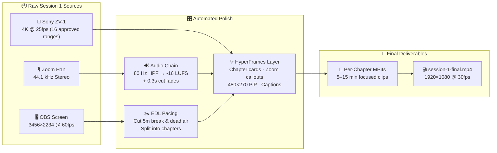
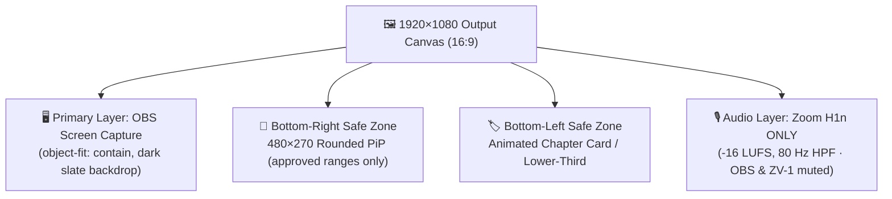
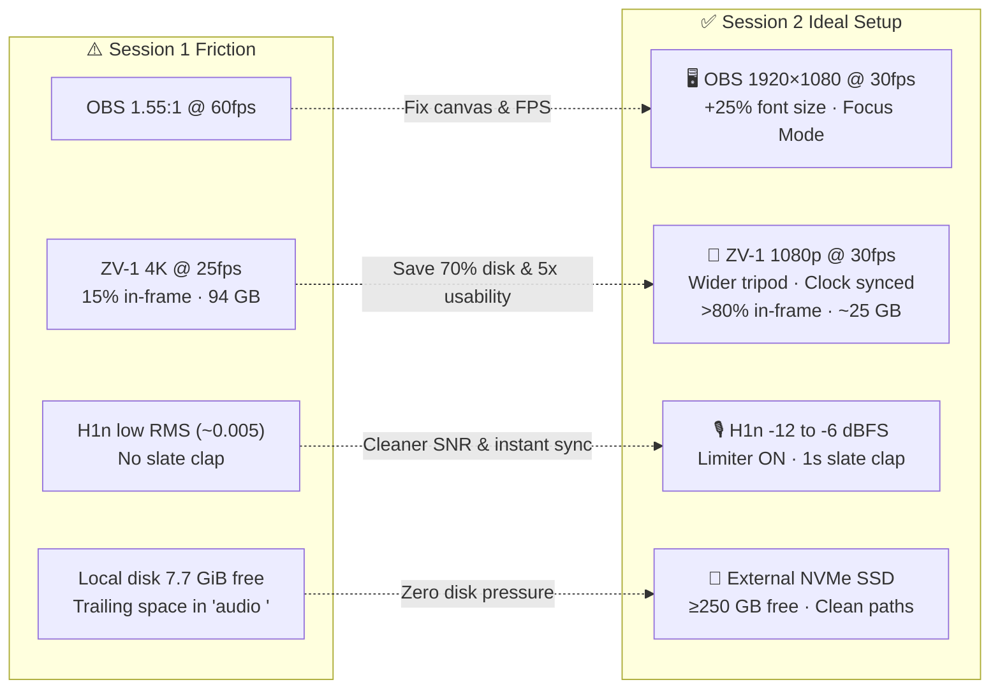

# ✨ How to Make This Video Better — Session 1 & Future Sessions

Practical, evidence-based improvements grounded in what we measured from the Session 1 footage:
- 🖥️ **OBS Screen Capture:** 3456×2234 @ 60 fps (`1.55:1`)
- 🎥 **Sony ZV-1 A-Roll:** 4K @ 25 fps (only **15.3%** usable in-frame presenter; 94 GB)
- 🎙️ **Zoom H1n Audio:** 44.1 kHz stereo (low raw RMS `~0.005`, needs loudness polish)

---

## 🗺️ Post-Production Upgrade Flow (Right Now)

---

## 🚀 1. Improvements We Can Apply Right Now (In This Edit)

### 🎧 Audio Polish (Biggest Immediate Quality Jump)
- 🔊 **Loudness normalize to −16 LUFS** (two-pass EBU R128 `loudnorm`). Raw Zoom H1n tracks average low RMS (`~0.005`), which sounds quiet on YouTube or a college VLE unless normalized.
- 🌊 **High-pass filter at 80 Hz** to strip room rumble, desk bumps, and HVAC hum without dulling voice clarity.
- ⚖️ **Check L/R balance & mono option:** Downmix to mono if the H1n X/Y capsules captured the speaker off-center so headphones sound centered.
- 🎚️ **0.3 s audio crossfades at every cut** so chapter and dead-air edits never click or pop.

### 🎨 Visual Polish (HyperFrames Advantage)
- 🔍 **Smart screen zoom & focus callouts:** Your OBS capture is **3456×2234** (~1.8× wider than 1080p!). We can smoothly zoom `1.25×–1.6×` onto code, terminal output, or tiny UI menus with zero blur.
- 🖼️ **Polished 16:9 framing for `1.55:1` screen:** Place the screen capture on a sleek dark slate backdrop (`#0b0d12`) with subtle elevation instead of harsh black bars.
- 🏷️ **Animated chapter title cards & lower-thirds:** GSAP-animated chapter banners at each topic shift help students orient immediately when scrubbing.
- 👤 **Selective A-roll only where it helps:** Keeping ZV-1 strictly to your **16 approved active-speech ranges** (PiP bubbles + closing cutaways) avoids out-of-frame shots.
- 💬 **Captions (`.srt` / `.vtt`):** Generated from the Whisper transcript (`edit/transcript.json`) for students watching on phones or muted laptops.

### ✂️ Pacing & Structure
- ⏩ **Cut the 5-minute mid-session break** (`18:59:36`–`19:04:26`) plus long dead air (≥ 8 s), setup fumbling, and false starts.
- 📚 **Focused 5–15 minute chapters:** Students rewatch short, titled chapters far more than a single 2-hour block.
- 🎣 **15-second cold open / hook:** Summarize what students will build/learn right at `00:00`.

---

## 📐 Frame Layout & Safe Zones

---

## 🎯 2. Improvements for Session 2 (Before & During Recording)

### 🎥 Camera & Framing (Sony ZV-1)
- 📏 **Lock framing to your speaking zone:** Pull the tripod slightly back or widen the lens with a desk/floor mark so you stay in frame **>80%** of the session (up from ~15%).
- 🎞️ **Match frame rates:** Set both OBS and ZV-1 to **30 fps** (eliminates 60 fps ↔ 25 fps pulldown jitter).
- 🕒 **Set the camera clock:** Fix the ZV-1 date/time (currently reads 2022) for effortless sorting.
- 💡 **Lock focus & white balance:** Face Priority AF + fixed white balance keeps the PiP look consistent across the whole class.

### 🎙️ Audio (Zoom H1n)
- 📈 **Raise input gain:** Aim for **−12 dB to −6 dB peaks** with the hardware **Limiter ON** for cleaner signal-to-noise ratio.
- 📍 **Keep mic distance consistent:** 20–30 cm from your mouth (or a clip-on lavalier into the H1n 3.5 mm jack) so volume stays steady when you turn toward the screen.
- 👏 **One sharp clap on camera** at the start of Part 1 and after the break — gives instant visual lip-sync verification alongside audio cross-correlation.

### 🖥️ Screen Capture (OBS)
- 📺 **Use a 16:9 canvas (`1920×1080` or `2560×1440`):** Removes MacBook Retina pillarboxing completely.
- 🔎 **Bump IDE / browser / terminal font size +25%:** Makes code readable on phones and classroom projectors.
- 🔕 **Enable macOS Do Not Disturb** and close unrelated browser tabs before hitting Record.
- ⏸️ **Pause OBS during breaks** instead of recording through 5 minutes of empty room.

### 💾 Storage & Workflow
- 💽 **Use an external NVMe SSD (≥ 250 GB free):** Recording ZV-1 at **1080p @ 30 fps** instead of 4K saves **~70% disk space** while staying 4× sharper than a 480×270 PiP box.
- 📁 **Clean folder names:** Use `audio` (no trailing space) so scripts and terminal tools stay friction-free.

---

## ✅ 3. Quick Pre-Flight Checklist for Session 2

- [ ] 🖥️ OBS set to `1920×1080` (or `2560×1440`) @ **30 fps** + editor/terminal font size **+25%**.
- [ ] 🎥 Sony ZV-1 set to **1080p @ 30 fps**, clock synced, wider tripod framing verified.
- [ ] 🎙️ Zoom H1n gain set for **−12 to −6 dB peaks**, limiter **ON**, 1-second clap on camera at start.
- [ ] 🔕 macOS **Focus / Do Not Disturb** turned ON.
- [ ] 💾 External SSD connected with **≥ 100 GB free** for raw footage + HyperFrames renders.
