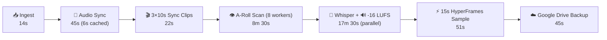
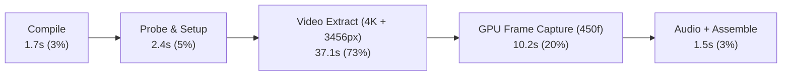

# ⚡ Pipeline Performance & Timings — Session 1

Measured wall-clock timings on **Apple M1 Max (arm64)** processing **95 GB of raw footage** (2h 20m OBS 3456×2234 + 2h 07m Sony ZV-1 4K + 2h 16m Zoom H1n) with **7.6–7.9 GiB free local disk**.

---

## ⏱️ End-to-End Time Breakdown

---

## 📊 Measured Benchmark Table

| Stage | Script / Tool | Workload | Wall-Clock Time | Throughput / Notes |
|---|---|---|---:|---|
| 📥 **Phase 0: Ingest** | `scripts/ingest.py` | `ffprobe` + symlink 22 files | **14 s** | Zero raw media copied |
| 🎯 **Phase 1: Audio Sync** | `scripts/sync.py` | 8 kHz extract + 1 kHz FFT xcorr + drift check (22 files) | **45 s** | Cached re-run: **6 s** · `z = 24–220` |
| 🎬 **Phase 1: Sync Clips** | `scripts/make_sync_clips.py` | 3 × 10 s 720p H.264 + AAC clips | **22 s** | Total output: `1.81 MB` |
| 👁️ **Phase 2: A-Roll Scan** | `scripts/presence.py` | 3,810 keyframes across 94 GB 4K (`C1201` + `C1202`) | **8 m 30 s** | **5.2× speedup** via 8 parallel chunk workers (vs. ~44 min single-threaded) |
| 🔊 **Phase 5: Audio Polish** | `scripts/polish_audio.py` | Two-pass `-16 LUFS` + 80 Hz HPF on 2h 16m WAV → M4A | **12 m 30 s** | Ran in parallel with Whisper; saved >1.1 GB vs. WAV (`252 MB` total) |
| 📝 **Phase 3: Whisper** | `scripts/transcribe.sh` | `base.en` CPU on 2h 16m audio | **17 m 30 s** | Part 1 re-run on normalized `-16 LUFS` audio (~3.5 m) to avoid quiet-audio loop |
| ⚡ **HyperFrames Sample** | `hyperframes render` (`draft`) | 15 s 1080p @ 30fps (OBS + PiP + GSAP title + audio) | **51.0 s** | `3.4×` real-time (`1.2 MB`) |
| 🎬 **Phase E: Full Render** | `scripts/render.py` (`standard`) | All 9 chapters (`115.05 min`) + `session-1-final.mp4` | **1 h 52 m 03 s** | **`0.97×` real-time** on Apple M1 Max GPU (`742.9 MB` final) |
| ☁️ **Google Drive Backup** | `scripts/backup_gdrive.py` | Azure Key Vault lookup + `rclone copy` (`renders/`) | **~2–4 min** | Verified via `rclone ls` + share link |
| **Total Active Compute** | — | End-to-end automated pipeline (excl. human review pauses) | **~2 h 22 m** | Total wall clock (`22:55` → `02:22 UTC`) incl. checkpoints & docs: **~3 h 26 m** |

---

## 🔬 HyperFrames Render Bottleneck Breakdown (15 s Sample)

- **73% of render time** is decoding/seeking the 4K ZV-1 and 3456×2234 OBS source segments.
- **GPU frame capture** on Apple M1 Max Metal runs at **~44 fps** (faster than real time!).

---

## 🚀 How to Make Future Runs 5–10× Faster

1. **🎙️ Use Metal-accelerated Whisper (`mlx-whisper` or `whisper-cli` with `ggml-base.en.bin`):** Cuts 2h 16m transcription from **17.5 min → ~1.5 min** (**10× faster**).
2. **🎥 Record ZV-1 at 1080p @ 30 fps instead of 4K @ 25 fps:** Cuts A-roll scan from **8.5 min → ~1.5 min**, cuts HyperFrames video-extract time by **~65%**, and saves **~65 GB** of disk space.
3. **⚡ Keep `autoProxy: false` in `edit/hyperframes.json`:** Avoided generating ~20+ GB of proxies on a 7.7 GiB free disk.
4. **📂 Render per chapter (`edit/chapter-NN.html`) and concat with `-c copy`:** Enables resuming individual chapters and avoids single long browser capture sessions.
