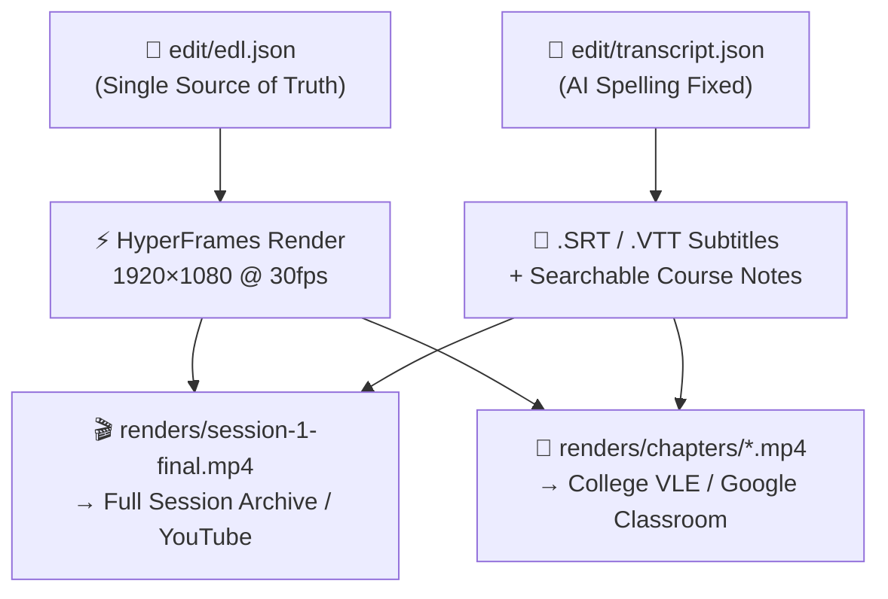

# 🎯 Recommendations — Sixth Form College AI Training Course (Session 1)

Tailored editorial, technical, and teaching recommendations to make your **AI Training Course** videos engaging, clear, and easy for sixth-form students to follow and rewatch.

---

## 🧭 Priority Impact Matrix

```mermaid
flowchart LR
    subgraph High["🔥 High Impact · Do Now"]
        H1["🎙️ Normalize Zoom H1n to -16 LUFS\n+ 80 Hz HPF"]
        H2["✂️ Cut 5m Break & Dead Air\nSplit into 5–15m Chapters"]
        H3["🔴 Red & White Animated\nChapter Cards"]
        H4["🤖 Fix AI Terms in Transcript\n(Claude, Anthropic, ChatGPT)"]
    end

    subgraph Med["⚡ High Value · Easy Add"]
        M1["💬 Export .SRT / .VTT Captions\nfor VLE & YouTube"]
        M2["🔍 Zoom Callouts on 3456×2234\nCode & Prompt Screens"]
        M3["👤 Approved PiP Bubbles\nOnly on Active Explanations"]
    end

    subgraph Next["🚀 Session 2 Upgrades"]
        N1["🖥️ 16:9 OBS Canvas @ 30fps\n+25% Font Size"]
        N2["🎥 ZV-1 1080p @ 30fps\nWider Tripod (>80% in-frame)"]
        N3["💾 External NVMe SSD\n+ 1s Slate Clap"]
    end

    High --> Med --> Next
```

---

## 🎓 1. Pedagogy & Student Engagement (AI Training Course)

- 🎣 **Open with a 15-second "What You'll Build" hook:** Show the end result first (e.g., a live Claude prompt or working app) before diving into setup.
- 🧩 **Micro-chapters (5–15 min each):** Sixth-form students revise by topic. Publish both the full session (`session-1-final.mp4`) and individual chapter MP4s (`renders/chapters/`).
- 📝 **Prompt & Tool Callouts:** Whenever you type a key prompt into **Claude**, **Claude Code**, or **ChatGPT**, display a brief red-and-white lower-third or zoom into the prompt box so students can read every word on mobile screens.
- 🧠 **Recap Slide / Summary Card at Chapter End:** A 5-second closing banner per chapter listing 2–3 key takeaways reinforces retention.

---

## 🎬 2. Editorial & Visual Recommendations

- 🖥️ **Keep OBS Screen Primary (~85–90% of runtime):** Students need to see your mouse, prompts, and output clearly.
- 👤 **Use Approved ZV-1 A-Roll Strategically (~10–15%):**
  - Use **bottom-right 480×270 PiP** during conceptual explanations where you're speaking directly and in frame.
  - Use **short full-frame cutaways** only for intros, transitions, and wrap-ups (like `R27–R30`).
- 🔴 **Consistent Red & White Branding:** Use the animated red-and-white chapter title cards across all sessions so the entire course feels like a cohesive series.
- 💬 **Always Ship Captions (`.srt` / `.vtt`):** With AI-domain spelling fixes (`Claude` not `cloud`, `Anthropic`, `ChatGPT`, `GitHub`, `VS Code`), captions double as a searchable study transcript.

---

## 🎧 3. Audio Recommendations

- 🎙️ **Zoom H1n Exclusive Mix:** Keep OBS and ZV-1 audio 100% muted/dropped — no room echo or camera hiss.
- 🔊 **Broadcast Loudness (−16 LUFS):** Two-pass `loudnorm` + 80 Hz high-pass filter ensures clear speech on laptop speakers, earbuds, and classroom projectors.
- 🎚️ **0.3 s Crossfades at Cuts:** Prevents jarring clicks when trimming dead air or the 5-minute mid-session break.

---

## 📦 4. Publishing & Distribution Flow

- 📺 **YouTube (Unlisted / Playlist):** Upload `session-1-final.mp4` with timestamped chapter markers pasted straight from `edit/edl.json` + `.srt` captions.
- 🏫 **College VLE / Google Classroom:** Upload the individual `renders/chapters/*.mp4` files so students can jump straight to a single exercise without downloading a 2-hour video.
- 🔗 **Companion Resources:** Pair each chapter video with the exact prompts, repo links, and a 3-question check-in quiz.

---

## 🛠️ 5. Quick Gear & Setup Recommendations for Session 2

| Area | Current (Session 1) | Recommended (Session 2) | Benefit |
|---|---|---|---|
| 🖥️ **OBS Canvas** | 3456×2234 (`1.55:1`) @ 60 fps | `1920×1080` or `2560×1440` (`16:9`) @ **30 fps** | Zero pillarboxing, matches camera FPS |
| 🎥 **Sony ZV-1** | 4K @ 25 fps (94 GB, ~15% in-frame) | **1080p @ 30 fps**, wider tripod framing, clock set | **~70% smaller files**, >80% usable A-roll |
| 🎙️ **Zoom H1n** | Low gain (`RMS ~0.005`), no clap | Gain for **−12 to −6 dBFS**, Limiter ON, 1s clap | Lower noise floor, instant visual sync |
| 💾 **Storage** | 7.7 GiB free on internal SSD | External NVMe SSD (**≥ 250 GB free**) | Effortless proxies & full 1080p renders |
| 📁 **Folders** | `audio ` (trailing space) | `audio` (clean name) | Zero shell-quoting gotchas |
