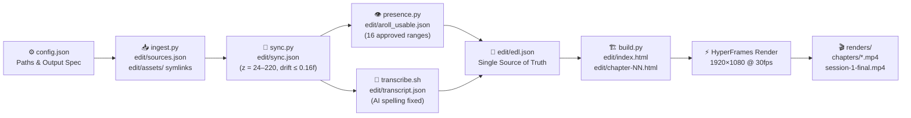

# 📐 Video Edit & Render Specifications — Session 1 (Sixth Form College)

Complete technical and editorial specification for editing and rendering **Session 1 (AI Training Course)** with **HyperFrames (`0.9.96`)**.

---

## 🗺️ Pipeline Architecture

---

## 1. 📦 Source Media Spec (Symlinked — Never Copied or Committed)

Footage root: `~/Movies/sixth from first session/production/` (overridable via `FOOTAGE_ROOT`).

| Track | Source Folder | Files | Format | Role in Final Mix |
|---|---|---|---|---|
| 🖥️ **Screen** | `screencapture/` | 18 × ~8 min splits (`17-51-53` … `20-08-44`) | H.264 `3456×2234` @ 60 fps, AAC 48 kHz | **Primary picture** (`object-fit: contain`), audio **muted** |
| 🎥 **A-Roll** | `aroll/` | `C1201.MP4` (60:26), `C1202.MP4` (66:34) | H.264 `3840×2160` @ 25 fps, PCM s16be | **Approved ranges only** (PiP / cutaway), audio **muted** |
| 🎙️ **Audio** | `audio ` ⚠️ trailing space | `ZOOM0030.WAV` (68:59), `ZOOM0031.WAV` (66:57) | PCM s16le 44.1 kHz stereo | **Exclusive audio track** (`ZOOM0032.WAV` ignored) |

---

## 2. 🎯 Synchronization Spec (`edit/sync.json`)

- **Master timeline:** `t = 0.000 s` anchored to `screen/2026-11-25_17-51-53.mp4`.
- **Method:** 8 kHz mono extraction → 1 kHz log-energy onset envelope → FFT cross-correlation.
- **Verification:** All 22 files synced with `z ≥ 24.0` (0 flagged); lip sync verified via 3 × 10 s clips (`renders/sync_check/`).

| Key Source | Master Offset (s) | Master Offset (ms) | Confidence (z) | Drift / Rate |
|---|---:|---:|---:|---|
| `audio/ZOOM0030.WAV` | `-218.8929 s` | `-218,892.9 ms` | `41.19` | `rate = 1.0` |
| `audio/ZOOM0031.WAV` | `4,347.3689 s` | `4,347,368.9 ms` | `59.93` | `rate = 1.0` |
| `aroll/C1201.MP4` | `299.9273 s` | `299,927.3 ms` | `204.89` | `-6.35 ms` (`-0.16 f @ 25`), `rate = 1.0` |
| `aroll/C1202.MP4` | `4,375.3074 s` | `4,375,307.4 ms` | `219.87` | `-3.29 ms` (`-0.08 f @ 25`), `rate = 1.0` |

---

## 3. 👤 Approved A-Roll Spec (`edit/aroll_usable.json`)

Only the **16 human-approved active-speech ranges** may appear in `edit/edl.json`:
- **PiP overlays (`screen+pip`, 480×270 rounded bottom-right):** `R10, R11, R12, R13, R15, R16, R19, R20, R22, R23, R24, R26`
- **Full-frame closing cutaways (`aroll`, 1920×1080):** `R27, R28, R29, R30`
- **Rejected / excluded (14 ranges):** `R01–R09, R14, R17–R18, R21, R25` (never shown)

---

## 4. 🎨 Visual, Title & Audio Output Spec

| Parameter | Specification |
|---|---|
| **Resolution & FPS** | `1920×1080` (`16:9`) @ `30 fps`, H.264 (`yuv420p`), `+faststart` |
| **Canvas Backdrop** | Dark slate `#0b0d12` (`object-fit: contain` for 3456×2234 OBS capture) |
| **PiP Styling** | `480×270`, bottom-right (`36px` inset), `16px` radius, subtle white border & drop shadow |
| **Chapter Title Cards** | **Red & white animated** (GSAP): white card, `#ef4444 → #b91c1c` gradient bar wipe, `#dc2626` pill badge, `#991b1b` bold title |
| **Audio Mix** | Zoom H1n ONLY — 80 Hz high-pass filter + two-pass EBU R128 `loudnorm` to **−16 LUFS** (`TP -1.5 dBTP`), `0.3 s` cut fades |
| **Transcript / Captions** | Whisper `base.en` with AI training course spelling fixes (`Claude`, `Claude Code`, `Anthropic`, `ChatGPT`, `OpenAI`, `GitHub`, `HyperFrames`) |

---

## 5. 🎬 Render Output Locations & Disk Budget

All media outputs live in `renders/` (gitignored; never committed):

| Deliverable | Path | Purpose |
|---|---|---|
| **Sample HyperFrames Render** | `renders/preview/session-1-preview.mp4` | 15 s live preview verifying OBS screen + approved PiP (`R10`) + red/white animated title + Zoom H1n audio |
| **Lip-Sync Verification Clips** | `renders/sync_check/sync_check_{1_start,2_middle,3_end}.mp4` | Phase A ±1 frame sync proof |
| **Per-Chapter MP4s** | `renders/chapters/<chapter-id>.mp4` | Individual topic videos for College VLE / Google Classroom |
| **Final Master MP4** | `renders/session-1-final.mp4` | Full concatenated session for YouTube / archive |

> 💾 **Disk Safety Rule:** `scripts/render.py` checks `df` free space before writing any render and requires estimated output size + **20% margin** (pass `--out-dir /Volumes/<SSD>/renders` if local disk is below threshold).
